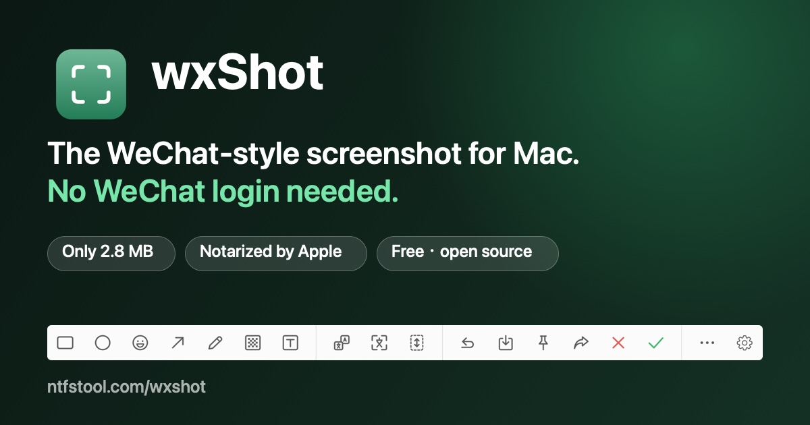
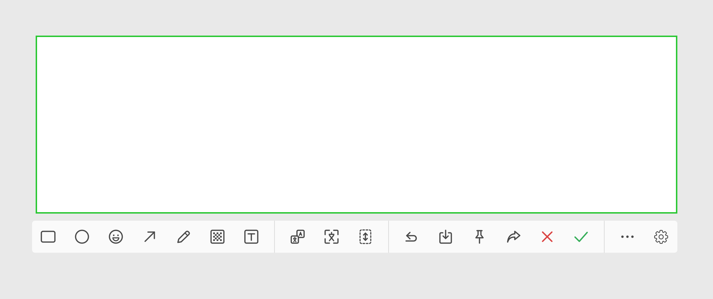
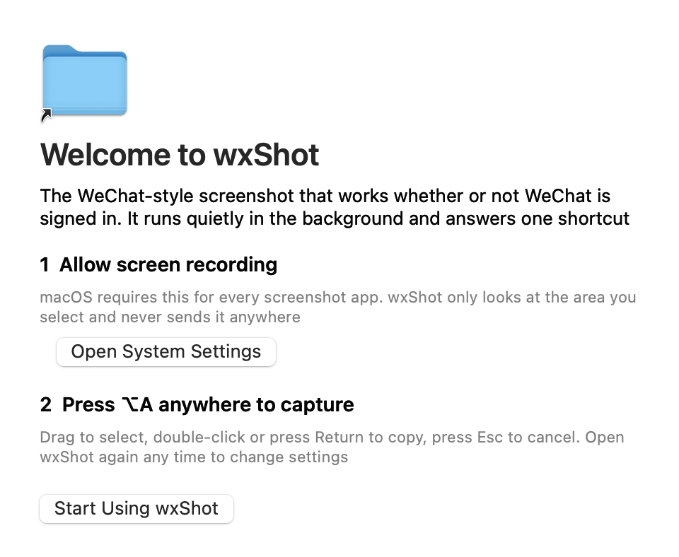
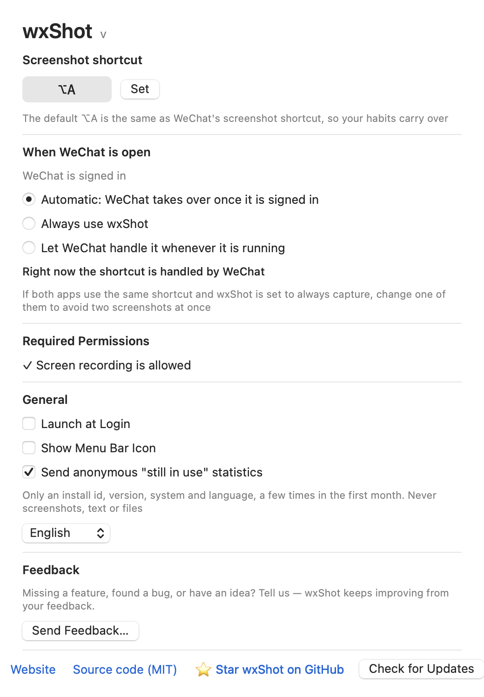

<p align="center">
  <a href="https://ntfstool.com/wxshot/"></a>
</p>

<h1 align="center">wxShot</h1>

<p align="center"><b>微信截图替代品 · 不登录微信也能用的 macOS 截图工具</b><br>
The WeChat-style screenshot for macOS that works when WeChat is not signed in.</p>

<p align="center">
  <a href="https://github.com/ntfstool/wxShot/releases/latest"></a>
  
  
  
</p>

<p align="center">
  <a href="https://github.com/ntfstool/wxShot/releases/latest/download/wxShot.dmg"><b>Download wxShot.dmg / 下载</b></a> ·
  <a href="https://ntfstool.com/wxshot/">Website &amp; animated demo / 官网与动画演示</a> ·
  <a href="https://ntfstool.com/wxshot/how-it-works/">How it works</a> ·
  <a href="https://ntfstool.com/wxshot/faq/">FAQ</a> ·
  <a href="https://ntfstool.com/wxshot/changelog/">Changelog</a>
</p>

## Highlights

- **Only 2.8 MB**, signed and **notarized by Apple**. Apple silicon and Intel.
- **Runs silently in the background**: no Dock icon, no menu bar icon by default. Press `⌥A` and it appears; open the app again for Settings.
- **WeChat's toolbar, exactly**: rectangle, ellipse, emoji, arrow, pen, mosaic, text | translate, extract text, long screenshot | undo, save, pin, share, close, confirm. A `···` menu holds numbered markers, redo and more tools.
- **Works when WeChat is closed or signed out**, and steps aside when WeChat is signed in (configurable).
- **Color picker lens**: coordinates and pixel color, `⌘C` copies it.
- **Extract text and translate on your Mac** (Apple Vision, Apple Translation). The screenshot sits on the left, the text on the right.
- **Long screenshot**: click, scroll slowly, done. The result is copied to the clipboard straight away.
- **Free, MIT, nothing leaves your Mac.** Screenshots, text and files are never uploaded.

<p align="center"></p>

## 中文

微信没登录、没打开，就不能截图？wxShot 是常驻后台的原生 macOS 截图工具，**手感和微信截图一样**：

- **仅 2.8 MB**，已由 Apple 签名并公证，支持 Apple 芯片和 Intel。
- **隐形后台**：无 Dock 图标，默认无菜单栏图标；按 `⌥A` 即用，再次打开 App 进入设置。
- **工具栏与微信一致**：矩形、圆、表情、箭头、画笔、马赛克、文字 | 翻译、提取文字、长截图 | 撤销、保存、钉住、分享、关闭、确认；「···」里有序号、重做等更多工具。
- **和微信共存**：微信没运行或没登录时由 wxShot 截图；微信登录后默认交还给微信。
- **取色放大镜**：显示坐标和色值，`⌘C` 复制。
- **文字提取与翻译**在本机完成，左边是截图、右边是文字，方便对照。
- **长截图**：点击后慢慢滚动，结束即复制到剪贴板。
- **免费、MIT 开源、不上传任何截图。**

## Install / 安装

Download [`wxShot.dmg`](https://github.com/ntfstool/wxShot/releases/latest/download/wxShot.dmg), drag wxShot to Applications, open it once and allow **Screen Recording** when macOS asks. Then press `⌥A` anywhere.
下载 DMG，拖进「应用程序」，首次打开按提示允许「屏幕录制」，之后在任何界面按 `⌥A` 即可。

```bash
brew install --cask wxshot   # once the cask is accepted / Homebrew 收录后可用
```

If the shortcut stops working after an update, remove wxShot under System Settings › Privacy & Security › Screen Recording, add it back and reopen the app.

<p align="center">
  
  
</p>

## Privacy / 隐私

No screenshot, text or file is uploaded. wxShot asks ntfstool.com once a day whether a new version exists (it sends only its own version) and, optionally, sends a few anonymous “still in use” pings in the first month (random install id, version, system, language, whether WeChat is running); both can be inspected in the source and the pings can be switched off in Settings.

## Feedback

Use **Settings › Send Feedback**, [open an issue](https://github.com/ntfstool/wxShot/issues), or write to service@ntfstool.com.

## More languages / 其他语言

[English](https://ntfstool.com/wxshot/) · [简体中文](https://ntfstool.com/lang/zhCN/wxshot/) · [繁體中文](https://ntfstool.com/lang/zhTW/wxshot/) · [日本語](https://ntfstool.com/lang/jp/wxshot/) · [한국어](https://ntfstool.com/lang/ko/wxshot/) · [Deutsch](https://ntfstool.com/lang/de/wxshot/) · [Français](https://ntfstool.com/lang/fr/wxshot/) · [Español](https://ntfstool.com/lang/es/wxshot/) · [Português](https://ntfstool.com/lang/pt/wxshot/) · [Italiano](https://ntfstool.com/lang/it/wxshot/) · [Русский](https://ntfstool.com/lang/ru/wxshot/) · [Türkçe](https://ntfstool.com/lang/tr/wxshot/) · [Tiếng Việt](https://ntfstool.com/lang/vi/wxshot/) · [ไทย](https://ntfstool.com/lang/th/wxshot/) · [हिन्दी](https://ntfstool.com/lang/hi/wxshot/) · [বাংলা](https://ntfstool.com/lang/bn/wxshot/) · [Kiswahili](https://ntfstool.com/lang/sw/wxshot/)

Also by NTFSTool: [NTFSTool](https://ntfstool.com/) (read and write NTFS drives on Mac) and [NTFS2exFAT](https://ntfstool.com/ntfs2exfat/).

## Build

```bash
swift build && swift test
scripts/build.sh            # dist/wxShot.app
```

PermissionFlow is vendored under `ThirdParty/`. wxShot is an independent project and is not affiliated with Tencent. "WeChat" is a trademark of its owner and is used only to describe compatibility.
